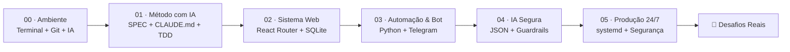

# Armazém — Kit Prático de Sistemas, Automações e IA

Tudo o que você precisa num lugar só — **método, ferramentas, configuração de IA e esqueletos de código prontos pra rodar** — para sair do básico e aprender a construir **sistemas web completos, bots e automações 24/7** na prática.

Sem curso teórico infinito: aqui a regra é **20% leitura direta ao ponto e 80% mão no código**.

---

## 🗺️ Por onde começar (O Caminho das Pedras)

Siga os 6 módulos da pasta **[`trilha/`](trilha/)** na ordem. Cada módulo leva menos de 1 hora e termina com algo real funcionando na sua máquina:



| Ordem | Módulo | O que você coloca pra rodar na prática |
|---|---|---|
| **00** | **[Ferramentas, Terminal e Git sem Medo](trilha/00-ferramentas-e-terminal.md)** | Terminal Linux/WSL, VS Code, Node, Python, Git e seu agente de IA |
| **01** | **[Como Construir com IA (Sem Virar Refém)](trilha/01-metodo-com-ia.md)** | Divisão Dono vs IA, `SPEC.md` de 1 página, fatias curtas e revisão por subagentes |
| **02** | **[Primeiro Sistema Web Completo](trilha/02-primeiro-sistema-web.md)** | App fullstack com tela, servidor e banco SQLite local em 4 comandos |
| **03** | **[Primeira Automação e Bot em Python](trilha/03-primeira-automacao-bot.md)** | Robô resiliente com SQLite WAL, alertas no Telegram e livro de auditoria |
| **04** | **[IA Dentro do Sistema (Guardrails)](trilha/04-ia-dentro-do-sistema.md)** | Padrão *"A IA propõe JSON, o código valida e trava"* contra alucinações |
| **05** | **[Rodando 24/7 e Segurança na Prática](trilha/05-rodando-24x7-e-seguranca.md)** | `systemd`, `.env` blindado, Tailscale, firewall e varredura com `gitleaks` |
| **🚀** | **[5 Desafios Práticos Graduais](desafios/PROJETOS-PRATICOS.md)** | Projetos do mundo real (Mini-CRM, Vigia Telegram, Triagem IA, Deploy 24/7) |

---

## 🧰 O que tem dentro deste Armazém

### 1. [`templates/`](templates/) — Código pronto pra clonar e usar
Esqueletos limpos, já com testes automáticos configurados, para você não começar da tela em branco:
- **[`templates/web-fullstack/`](templates/web-fullstack/)**: React Router v8 + React 19 + Tailwind CSS v4 + TypeScript `strict` + Prisma + SQLite + Biome + Vitest + Dockerfile.
- **[`templates/automacao-python/`](templates/automacao-python/)**: Bot/monitor em Python puro + SQLite em modo WAL + alertas no Telegram + aprovação humana auditada + unit file do `systemd` + `pytest`.
- **[`templates/agente-com-guardrails/`](templates/agente-com-guardrails/)**: Motor de atendimento/triagem com simulador interativo offline (grátis pra estudar) e conector para LLM local/API, provando em testes que nenhuma resposta proibida vaza para o cliente.

### 2. [`kit-ia/`](kit-ia/) — O Cérebro Operacional da sua IA
As instruções e subagentes que usamos nos projetos reais para manter a IA disciplinada:
- **[`CLAUDE-BASE.md`](kit-ia/CLAUDE-BASE.md)** e **[`SPEC-TEMPLATE.md`](kit-ia/SPEC-TEMPLATE.md)**: copie para a raiz de todo projeto novo.
- **[`agents/`](kit-ia/agents/)**: revisores especialistas (`architect`, `bug-hunter`, `security-auditor`).
- **[`commands/`](kit-ia/commands/)**: comandos rápidos (`/plan-feature`, `/audit`, `/fix`).
- **[`skills/conselho/`](kit-ia/skills/conselho/SKILL.md)**: protocolo para tomar decisões difíceis ouvindo negócio, técnica e revisor crítico sem viés.
- **[`memoria-obsidian/`](kit-ia/memoria-obsidian/README.md)**: templates curtos de Decisão, Incidente e Aprendizado para nunca perder contexto entre conversas.

---

## ⚡ Comece nos próximos 5 minutos

```bash
# 1. Clone o Armazém
git clone https://github.com/g-Ac/Armazem.git
cd Armazem

# 2. Faça um teste rápido rodando o simulador de IA com Guardrails (usa só Python padrão!)
python3 templates/agente-com-guardrails/simular_conversa.py
```

Depois abra o **[`trilha/00-ferramentas-e-terminal.md`](trilha/00-ferramentas-e-terminal.md)** e siga passo a passo!

---

## 🔗 Quer ver como tudo isso vira infraestrutura real?

Depois de dominar os fundamentos aqui do Armazém, visite o repositório **[`g-Ac/homelab`](https://github.com/g-Ac/homelab)** para ver esses mesmos princípios (medir antes de construir, segurança defensiva, gateway de IA local + nuvem e agente SRE com aprovação no Telegram) rodando de verdade em hardware doméstico.

---

## Licença

Distribuído sob licença [MIT](LICENSE). Use, estude, modifique e construa seus próprios sistemas à vontade!
