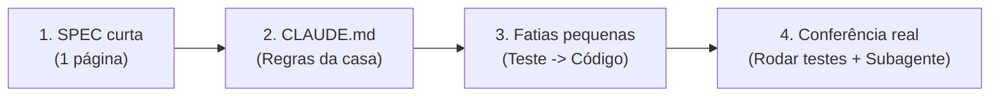

# Módulo 01 — Como Construir Sistemas com IA (Sem Virar Refém)

> **Tempo estimado:** 20 minutos
> **Meta prática:** aprender a dirigir a IA como um **Dono de Produto + Engenheiro**, em vez de jogar pedidos vagos e receber código quebrado que ninguém entende.

---

## O erro que 90% dos iniciantes cometem com IA

A maioria abre o chat e digita:
> ❌ *"Faz um sistema completo de controle financeiro com login, gráficos, WhatsApp e IA."*

O que acontece? A IA cospe 25 arquivos de uma vez, metade não conecta com a outra metade, aparece um erro vermelho gigante e você fica travado porque não sabe nem por onde começar a consertar.

## Como nós fazemos na prática (O Método em 4 Regras)

### Regra 1: Você manda no Produto; a IA propõe a Técnica
Você **não precisa saber decorado** o nome de todos os comandos avançados de TypeScript ou SQL para mandar bem no projeto. Mas você **precisa decidir com clareza**:
- Qual dor real estamos resolvendo?
- O que entra agora na versão 1 (e o que fica pra depois)?
- O que nunca pode acontecer (ex: perder dados, vazar senha, prometer preço errado)?

Antes de criar qualquer sistema novo, preencha o arquivo **[`kit-ia/SPEC-TEMPLATE.md`](../kit-ia/SPEC-TEMPLATE.md)** (leva 10 minutos e economiza 10 horas).

### Regra 2: Toda pasta de projeto tem um `CLAUDE.md`
A IA não lê sua mente. Quando você coloca um arquivo `CLAUDE.md` na raiz do projeto (veja o modelo pronto em **[`kit-ia/CLAUDE-BASE.md`](../kit-ia/CLAUDE-BASE.md)**), toda sessão já começa sabendo:
- Qual stack usar (e não inventar biblioteca nova sem pedir);
- Que deve falar em **português simples**, traduzindo jargões técnicos;
- Que **nunca pode dizer "pronto"** sem rodar os testes na sua frente.

### Regra 3: Construa em fatias finas (1 funcionalidade por vez)
Nunca peça 5 telas de uma vez. Trabalhe sempre nesta escadinha:
1. *"Leia o `CLAUDE.md` e me proponha o plano para criar apenas a tabela de Clientes e a listagem simples, sem editar arquivos ainda."*
2. Você lê o plano de 10 linhas, vê se faz sentido e aprova: *"Pode implementar."*
3. A IA cria o teste, cria o código, roda os testes e você testa no navegador/terminal.
4. Funcionou? `git commit`! Agora você tem um chão firme antes do próximo passo.

### Regra 4: A IA que revisa não confia cegamente na IA que escreveu
No **[`kit-ia/`](../kit-ia/README.md)** deixamos subagentes e comandos prontos:
- Terminou uma etapa? Rode `/audit` ou chame o agente `bug-hunter` e `security-auditor`.
- Está em dúvida entre dois caminhos importantes? Use a skill **[`conselho`](../kit-ia/skills/conselho/SKILL.md)** para ouvir pontos a favor, riscos e a alternativa mais simples antes de decidir.
- Descobriu algo importante ou tomou uma decisão grande? Salve no seu **[`memoria-obsidian/`](../kit-ia/memoria-obsidian/README.md)**.

---

## Bons Prompts vs Prompts Ruins (Copie e Use!)

| Situação | ❌ Prompt Ruim | ✅ Prompt Prático que Funciona |
|---|---|---|
| Começar algo novo | *"Cria uma tela de vendas aí"* | *"Leia o `CLAUDE.md`. Quero criar uma rota `/vendas` onde cadastro cliente, valor e data. Antes de codar, me mostre um plano curto do banco e da tela e me diga se ficou alguma dúvida."* |
| Quando dá erro | *"Deu erro, arruma"* | *"Ao clicar em Salvar apareceu este erro no terminal: `[cole o erro]`. Encontre a causa raiz, crie um teste que reproduza esse problema, corrija e me explique em 3 linhas simples o que causou."* |
| Aprender enquanto faz | *(Aceitar código sem entender nada)* | *"Funcionou! Agora me explique em 5 linhas simples como o formulário dessa tela chega até o banco SQLite, pra eu aprender o padrão."* |

---

## ✅ Entrega prática deste módulo

1. Instale os agentes e comandos do `kit-ia/` seguindo as 4 linhas do **[`kit-ia/README.md`](../kit-ia/README.md)**.
2. Abra o arquivo **[`kit-ia/CLAUDE-BASE.md`](../kit-ia/CLAUDE-BASE.md)** e leia inteiro (leva 3 minutos).
3. Parta para colocar seu primeiro sistema web de pé no **[Módulo 02 — Primeiro Sistema Web](02-primeiro-sistema-web.md)**!
