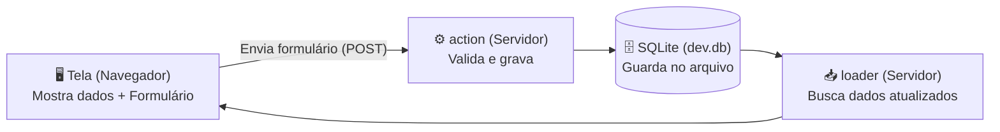

# Módulo 02 — Seu Primeiro Sistema Web Completo

> **Tempo estimado:** 45 a 60 minutos
> **Pasta de trabalho:** [`templates/web-fullstack/`](../templates/web-fullstack/)
> **Meta prática:** subir um sistema web real com banco de dados local e criar **sua própria funcionalidade nova** (cadastro + filtro + botão de concluir).

---

## 1. Entendendo como um Sistema Web funciona (sem complicação)

Todo sistema web útil (um CRM, um controle de estoque, um painel de chamados, um micro-SaaS) faz basicamente **3 movimentos**:



No nosso template **[`templates/web-fullstack`](../templates/web-fullstack/)**, essas 3 coisas moram **juntas no mesmo arquivo de rota**! Olhe depois o arquivo [`app/routes/notes.tsx`](../templates/web-fullstack/app/routes/notes.tsx):
- `loader()`: roda no servidor **antes** de abrir a página e busca as notas no banco.
- `action()`: roda no servidor quando você aperta o botão **Add**, grava no banco e atualiza a tela automaticamente.
- `Notes()`: desenha o HTML bonito na tela usando classes do Tailwind CSS.

Zero mágica escondida em 15 pastas diferentes.

---

## 2. Subindo o sistema agora no seu computador

Abra o terminal e rode:

```bash
cd ~/projects/Armazem/templates/web-fullstack

# 1. Cria seu arquivo .env local
cp .env.example .env

# 2. Instala os pacotes
npm install

# 3. Cria o arquivo do banco SQLite (dev.db) com a tabela Note
npx prisma migrate dev

# 4. Roda os testes para ver que está tudo verde
npm test

# 5. Liga o servidor!
npm run dev
```

Abra **http://localhost:5173/notes** no navegador.
Adicione 2 ou 3 anotações. Depois pare o servidor (`Ctrl + C`), suba de novo (`npm run dev`) e recarregue a página: **suas notas continuam lá** porque estão gravadas de verdade no banco SQLite!

---

## 3. Mão na massa: criando uma funcionalidade nova com a IA

Agora vamos sair do exemplo pronto e construir uma página **`/tarefas`** (um controle de tarefas com título, prioridade `alta | normal` e botão de "Concluir").

Abra outro terminal dentro de `templates/web-fullstack`, inicie seu agente de IA (`claude`, `codex`, etc.) e mande este pedido:

```text
Leia o CLAUDE.md e use app/routes/notes.tsx como referência.
Quero criar uma nova rota /tarefas para controlar tarefas do dia:
1. Cada tarefa tem: id, titulo, prioridade ("alta" ou "normal"), concluida (boolean, começa false) e createdAt.
2. Na tela /tarefas quero:
   - Formulário para criar tarefa escolhendo a prioridade;
   - Lista mostrando tarefas pendentes primeiro, com selo visual nas de prioridade "alta";
   - Botão "Concluir" em cada tarefa pendente que marca concluida = true no banco;
   - Função pura em app/lib/ para ordenar/validar prioridades com teste em Vitest.

Antes de alterar arquivos, me mostre o plano curto em português simples.
```

### O que observar enquanto a IA trabalha:
1. Ela vai adicionar `model Task` em `prisma/schema.prisma` e rodar `npx prisma migrate dev --name add_tasks` + `npx prisma generate`.
2. Vai criar a função pura com teste em `app/lib/` e a tela em `app/routes/tarefas.tsx`.
3. Vai registrar `/tarefas` em `app/routes.ts`.
4. Vai rodar `npm run typecheck`, `npm test` e `npm run lint`.

---

## ✅ Entrega prática deste módulo (Critério de Pronto)

- [ ] Você abriu `http://localhost:5173/tarefas`, criou uma tarefa de prioridade **alta**, clicou em **Concluir** e viu atualizar no banco.
- [ ] Rodou `npm test && npm run typecheck && npm run lint` no terminal e os 3 passaram sem erros!
- [ ] Entendeu para que servem `prisma/schema.prisma`, `loader` e `action`.

Tudo verde? Bora automatizar tarefas em segundo plano no **[Módulo 03 — Primeira Automação e Bot](03-primeira-automacao-bot.md)**!
